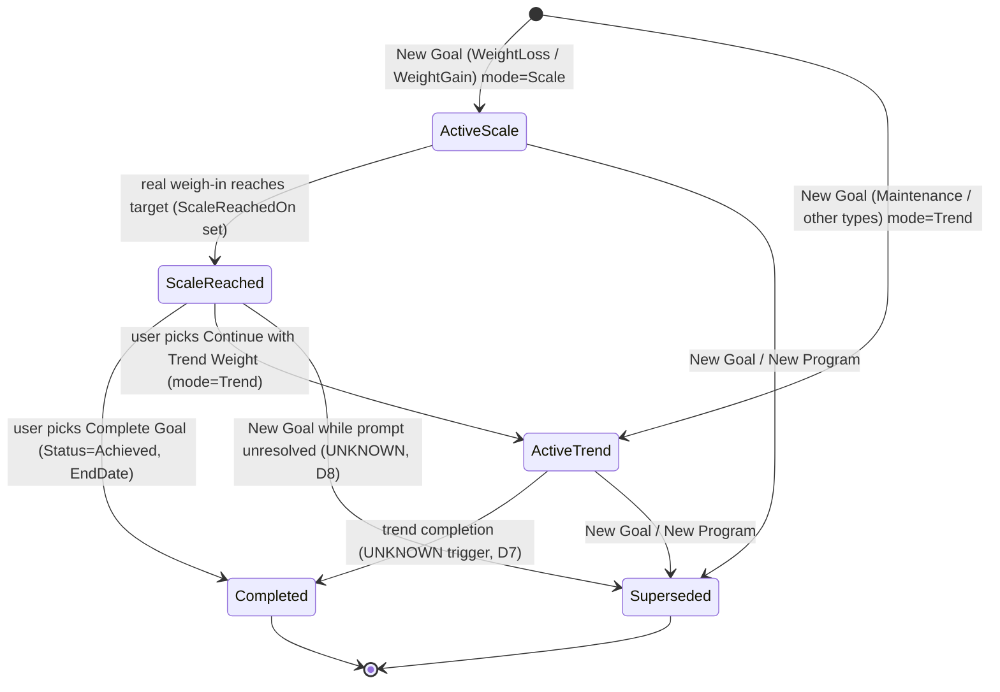
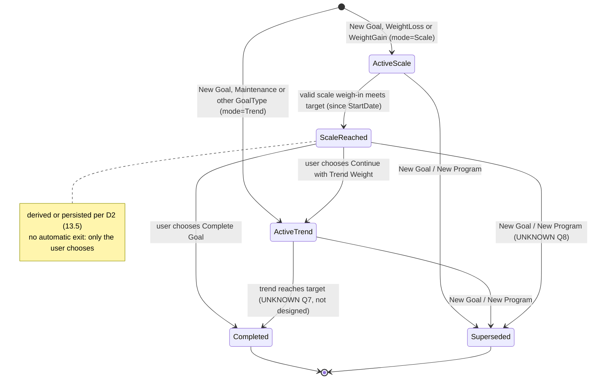

# Goal Tracking Mode (Scale vs Trend) — DESIGN PROPOSAL (not implemented)

Status: **proposal only**, 2026-10-23. No code, no migration file in the tree (S27 stays the only pending migration; S28 below is a text proposal). Nothing committed/pushed/deployed, no DB touched. Waiting for the user's review.

> **UPDATE 2026-10-23 (later): S28 created on the user's instruction ("Cứ tạo migration rồi update đi cho tôi" → "Tạo S28 (Goal Tracking)").** Schema only, per §13.2 / D2-O1 (derive; no achievement column): `Goals.TrackingMode nvarchar(10) NOT NULL DEFAULT 'Trend'` + `CK_Goals_TrackingMode`, `Goals.StartScaleWeightKg decimal(5,2) NULL`. File `20261023103247_S28_GoalTrackingMode`. No handler/API/FE behaviour changed (every goal still behaves as Trend; nothing writes the new columns yet). Applied **only** to the isolated LocalDB `MacroOS_IT` (31 migrations; Down→S27 and re-Up verified). **Applied to production on 2026-10-23 on the user's direct confirmation** ("Apply S28 to production. I confirm production writes are allowed again for this one migration"): `dotnet ef database update` to S28 only; prod history now ends at S28; the one existing Goal row reads `TrackingMode = Trend`, `StartScaleWeightKg = NULL`; the old API build on MonsterASP keeps working (additive columns with a default).
>
> **Revision 3 (2026-10-23) — the user has now answered D1–D13 (quoted in §13.1).** §13 is the authoritative proposal: final minimum schema, old-goal mapping, state diagram, D2 design options (no column chosen), D8 impact on Program/Strategy, D11 target-edit proposal, rollback, tests, and the UNKNOWN questions. **§3 Scale-mode column, §4.1–§4.5 and §9 "default" columns are superseded by §13** (kept only as history). **S28 is NOT approved**: no migration file exists or will be created until the user approves §13 separately.

> **Revision 2 (2026-10-23).** The user did **not** approve the defaults in §9 ("Không tự sử dụng mặc định D1–D13 và không bắt đầu migration S28 … Tôi sẽ duyệt từng vấn đề trước khi implement"). Treat §3–§4 and the "default" column of §9 as **illustrative drafts only**. The decision-by-decision matrix for the user's approval is **§11**; the official-MF research for D12 is **§12** (it supersedes the claim in §0 that no MF text exists for the goal-reached prompt: official MF pages do describe it, only the screens/labels are missing).

## 0. How to read the evidence tags

| Tag | Meaning |
|---|---|
| **USER DECISION** | Stated by the user on 2026-10-23 (quoted in §1). Binding, not re-argued here. |
| **VERIFIED MF** | Marked ✅ in the user-verified MF analysis docs (`Docs/MacroFactor_UI/Phan_Tich_Chi_Tiet/*`). Text only unless a screenshot is named. |
| **OBSERVED MF** | Seen in an MF screenshot stored in the repo (file named). |
| **MACROOS POLICY** | A choice made here to fill a gap; not claimed as MacroFactor behaviour; needs approval. |
| **UNKNOWN** | No evidence in the repo. Listed in §8 for the user to decide; the design does not assume an answer. |

Repo evidence for Scale/Trend is thin. All of it:
- `Docs/MacroFactor_UI/Phan_Tich_Chi_Tiet/02_Goal_Va_Program.md:19,26` — **VERIFIED MF (text)**: New Goal wizard "Target weight" chosen by scale or trend; "Đạt scale goal → app hỏi 'tiếp tục tới trend goal?'". `:80` Maintenance = dial around the **target trend weight**.
- `.../09_Danh_Sach_Chuc_Nang_Chi_Tiet.md:19,22` — F-B01 (target weight scale\|trend) partial, **F-B04 "Scale goal → trend goal" = not built**.
- `Docs/MacroFactor_UI/UI/Dashboard/Energy_Balance_v2/07_goal_progress_expand_button.png` — **OBSERVED MF**: Goal Progress page has two tabs `Scale Weight` / `Trend Weight`, **Scale Weight is the selected (default) tab**, shows "Distance 4.7 kg, <start date> – Today" and a waterfall.
- `Docs/MacroFactor_UI/UI/Get_Started/Goal/1.png … 6.png` — **OBSERVED MF**: New Goal wizard = goal type (Lose/Maintain/Gain) → target weight slider + rate slider (initial daily budget, projected end date) → "Goal summary" (`79 kg » 83 kg`, Goal Rate, Initial Daily Budget, Estimated End Date). **No Scale/Trend picker appears anywhere in the wizard screens**, which does not match the text claim in `02_…md:26`. Reported, not resolved.
- **No MF screenshot exists in the repo for the "goal reached" screen (Complete Goal / Continue with Trend), for how Goal History shows a completed goal, or for what happens to the program after completion.** (Rev 2: official MF web pages do describe the scale-goal "confetti" option in text — see §12 — but still no screen, button labels, history marker or post-completion program behaviour.)

## 1. Goal Tracking Rules (the user's words, verbatim, **USER DECISION**)

> "Weight Loss / Weight Gain: mặc định bắt đầu với Scale Weight. Khi Scale Weight đạt Target, user được chọn Complete Goal hoặc Continue with Trend Weight. Không tự chuyển sang Trend Mode nếu user chưa chọn. Khi tiếp tục với Trend Weight, Goal Progress sử dụng Trend Weight theo logic đã xác minh. Maintenance tiếp tục sử dụng Trend Weight. Muscle Gain và các GoalType khác phải được audit riêng, không tự áp dụng quy tắc nếu chưa xác minh."
> "Không thay đổi Program StartWeightKg hoặc thuật toán Expenditure chỉ vì thêm GoalTrackingMode."
> "Goal cũ cần được bảo toàn hành vi; nếu hiện tại dùng Trend thì migration mặc định Trend cho các goal đó. Goal mới sử dụng default theo GoalType."

Consequences used throughout:
1. Mode is per **Goal** row, default from `GoalType` at creation. The user never picks it in New Goal (matches the screenshots: no picker).
2. Scale→Trend happens **only** by the user's explicit "Continue with Trend Weight" (an endpoint call). Never automatic.
3. Everything outside the Goals feature is untouched: `Goal.StartWeightKg`, program targets, expenditure, check-in, weight trend.

## 2. What exists today (audit, file:line) — the baseline that old goals must keep

| Item | Today | Source |
|---|---|---|
| Goal entity | `TargetWeightKg, StartWeightKg (trend snapshot), RatePerWeekKg, StartDate, EndDate, Status, RowVersion`. **No mode, no scale start, no reached date.** | `Domain/Entities/Metrics/Goal.cs:4-17` |
| `GoalType` | `WeightLoss, WeightGain, MuscleGain, Maintenance, Endurance, Flexibility`; direction: Muscle→Gain, Endurance/Flexibility→Maintain (marked "pending user decision") | `Domain/Enums/Users/GoalType.cs:3`, `Application/Features/Goals/GoalRules.cs:13-20` |
| `GoalStatus` | `Active, Achieved, Superseded, Cancelled`. **`Achieved` and `Cancelled` are never written anywhere in BE/src** (grep); only `Superseded` (CreateProgram) | `Domain/Enums/Metrics/GoalStatus.cs:3`, `CreateProgramCommandHandler.cs:70-74` |
| Start Weight | `StartWeightKg` = latest `TrendWeightKg ?? WeightKg` at start | `CreateProgramCommandHandler.cs:21-26,81`; `GoalSupport.cs:21-25,33` |
| Current Weight | latest TREND point since `StartDate`, else `StartWeightKg` | `GetGoalProgressQueryHandler.cs:13-20` |
| Target Weight | `Goal.TargetWeightKg` (single source) | `Goal.cs:8` |
| Goal Progress % | `(Start − current trend) ÷ (Start − Target)`, clamp 0–100, null if Maintenance/Start=Target | `GoalProgressCalculator.cs:6-10`, handler `:23` |
| ETA | trend points, 2-point 14-day slope, anchored on last weigh-in, gated (TRA / G=14 / stale), `GoalAchieved` when last **trend** ≤/≥ target | `GoalProgressCalculator.cs:45-67`, handler `:26-28` |
| Completion | none persisted. Only ETA status `GoalAchieved`; FE computes `reached` per tab locally | `GoalProgressCalculator.cs:52`; FE `goal-progress.utils.ts:140` |
| Check-in | trend series and trend rate only; never reads Goal start/mode | `CheckIns/CheckInSupport.cs:28-36,58` |
| Auto-backfill hazard | `EnsureActiveGoalAsync`: when the user has **no Active goal** and has an active program, it **builds a new Goal from the program** and saves it | `GoalSupport.cs:9-42` |

So today every goal behaves as **Trend mode**. That is the behaviour the migration must preserve (§4.3).

## 3. Definitions per mode (Start / Current / Target / Progress / ETA / Completion)

| | **Trend mode** (= today, unchanged) | **Scale mode** (new default for WeightLoss/WeightGain) |
|---|---|---|
| Start Weight | `StartWeightKg` (trend snapshot) — unchanged | **Option A (recommended, MACROOS POLICY):** new `StartScaleWeightKg` = latest raw `WeightKg` with `LogDate ≤ StartDate` (carry-forward, same lookup as `GoalSupport.cs:21-25` but raw). **Option B:** reuse `StartWeightKg` (trend) as Start in both modes (FE does this today: the Scale tab draws Day 0 from `startWeightKg`, `use-goal-progress-detail.ts:28,34`). UNKNOWN which MF uses → decision D3. |
| Current Weight | latest trend point on/after `StartDate`; none yet → Start | latest **raw** weigh-in on/after `StartDate`, with its date (`currentScaleDate`); none yet → `StartScaleWeightKg`. Stale rule reuses the existing 7-day `STALE_WEIGHT_DATA` boundary (`GoalProgressCalculator` tests d26/d27): the value is still shown but flagged stale and **never triggers "reached"** from a carried value (only a real weigh-in can reach). MACROOS POLICY. |
| Target Weight | `TargetWeightKg` | `TargetWeightKg` (same field) |
| Goal Progress % | existing formula on trend | same formula on scale: `(StartScale − currentScale) ÷ (StartScale − Target)`, clamp 0–100. MACROOS POLICY (MF formula UNKNOWN). |
| ETA | existing (trend slope, trend position, gate) | **Recommended (MACROOS POLICY): mode-independent** — keep the trend-rate ETA from the trend position (damps scale noise, no new algorithm, no expenditure change). Exception: Scale mode + reached → status `GoalAchieved`. Alternative: remaining distance measured from the last scale value with the trend slope (more jitter). Decision D6. |
| Completion criteria | none (ETA status only). Prompt on trend reach is UNKNOWN (D7) | `reached` ⇔ a real weigh-in on/after `StartDate` with scale ≤ target (Loss) / ≥ target (Gain), equality counts (same operator as `GoalProgressCalculator.cs:52`). Persisted as `ScaleReachedOn` (first such weigh-in date). Then the user chooses (USER DECISION): **Complete Goal** or **Continue with Trend Weight**. |
| Maintenance (any mode) | trend dial: `current trend − target` (`GetGoalProgressQueryHandler.cs:24`) | not applicable — Maintenance is always Trend (USER DECISION) |

After **Continue with Trend Weight**: `TrackingMode = Trend`; the goal keeps `StartWeightKg` (trend snapshot, never rewritten), so progress is simply the existing verified trend logic from the original start. Progress may show < 100 % right after the switch because trend lags scale: this is expected, not a bug.

Never changed by this feature: `Goal.StartWeightKg` and how it is written, program targets, `InitialTdeeResolver`, expenditure, check-in, weight trend, `WeightEntry`.

## 4. Backend design

### 4.1 Entity / schema changes (`Goal`)

| Column | Type | Null | Default | Purpose |
|---|---|---|---|---|
| `TrackingMode` | enum `GoalTrackingMode { Trend, Scale }`, stored as string `nvarchar(10)` (project convention for enums) | NOT NULL | `'Trend'` | basis of Progress/Current/Completion |
| `StartScaleWeightKg` | `decimal(5,2)` | NULL | — | Option A only. Raw scale start for Scale-mode goals; NULL for old/Trend goals |
| `ScaleReachedOn` | `date` (user-local) | NULL | — | first weigh-in date that reached the target in Scale mode; persisted so a later edit/regression does not silently flip the prompt (D2) |
| `TrackingModeChangedOn` | `date` | NULL | — | date the user chose Continue with Trend (history/audit; optional, drop if not wanted) |
| CHECK `CK_Goals_TrackingMode` | `[TrackingMode] IN ('Trend','Scale')` | | | integrity |

No new table, no index (Goals is small and filtered by `UserId`; the existing access path is unchanged). `Status`/`EndDate` are reused for completion: `Achieved` + `EndDate = local today` (first writer of `Achieved`, today dead). The completed goal keeps its `TrackingMode` = the basis it was completed on, so no separate "completed basis" column is needed.

### 4.2 Defaults by GoalType (new goals only, set server-side in `CreateProgramCommandHandler` Goal creation, `:75-85`)

| GoalType | TrackingMode | Evidence |
|---|---|---|
| WeightLoss, WeightGain | **Scale** | USER DECISION |
| Maintenance | **Trend** | USER DECISION |
| MuscleGain, Endurance, Flexibility | **Trend** (= today's behaviour; no new rule applied) | USER DECISION: "audit riêng, không tự áp dụng". Separate audit needed (D9): MuscleGain has direction Gain (`GoalRules.cs:17`) so it *could* use Scale; Endurance/Flexibility are Maintain with pending direction decisions. |

The default is a pure function `GoalTrackingRules.DefaultFor(GoalType)`; no request field is added to New Goal / onboarding (matches the MF wizard screenshots).

### 4.3 Migration proposal "S28_GoalTrackingMode" (additive; **text only, to be generated only after approval; S27 must be applied/approved first**)

```sql
ALTER TABLE [Goals] ADD [TrackingMode] nvarchar(10) NOT NULL CONSTRAINT [DF_Goals_TrackingMode] DEFAULT N'Trend';
ALTER TABLE [Goals] ADD [StartScaleWeightKg] decimal(5,2) NULL;
ALTER TABLE [Goals] ADD [ScaleReachedOn] date NULL;
ALTER TABLE [Goals] ADD [TrackingModeChangedOn] date NULL;
ALTER TABLE [Goals] ADD CONSTRAINT [CK_Goals_TrackingMode] CHECK ([TrackingMode] IN (N'Trend', N'Scale'));
```
- **Backfill rule:** every existing row becomes `Trend` through the column default (current behaviour preserved, including Active WeightLoss/WeightGain goals; nothing silently flips to Scale). Other columns stay NULL: no data is read or rewritten. No duplicate/violation precondition (unlike S27), so no guard needed.
- **Down:** drop the CHECK, the default constraint and the four columns. Data lost on rollback = only the new columns (modes, reached dates); `Status/EndDate` of any goals completed meanwhile remain. If completions were made in Scale mode, rolling back makes them look like Trend-completed goals — acceptable, document it.
- Same safeguards as S27: generated with the unreachable-connection / Release / `--no-build` EF recipe, verified `has-pending-model-changes` clean, Up/Down tested on an isolated LocalDB DB, never applied to the shared DB without the user's separate approval; because `Program.cs` migrates on start, a BE deploy would apply it, so it ships only with the user's explicit OK.

### 4.4 API / DTO changes (all additive; existing fields keep their meaning)

| Endpoint | Change |
|---|---|
| `GET /api/goals/progress` (`GoalProgressResponse`) | add `trackingMode` (`"Scale"\|"Trend"`), `state` (`"ActiveScale"\|"ScaleReached"\|"ActiveTrend"\|"Completed"`), `startScaleWeightKg?`, `currentScaleKg?`, `currentScaleDate?`, `scaleReachedOn?`, `weeks[].scaleKg?` (raw last-of-week; closes the "Scale weeks" gap noted in `Docs/Design/BE_Fix_Plan_B1_B3.md:192`). **`progressPercent` and `eta*` follow the goal's mode** (Trend goals = byte-identical to today). `currentTrendKg`, `weeks[].trendKg/deltaKg`, `startWeightKg` unchanged. |
| `GET /api/goals/history` (`GoalHistoryItemModel`) | add `trackingMode`. Display change only if MF reference exists (D10). |
| `POST /api/goals/current/complete` (new) | valid only in state `ScaleReached`: `Status = Achieved`, `EndDate = local today`. Idempotent (second call = same result). Other states → 409 + `reasonCode` (`GOAL_NOT_REACHED`, `GOAL_ALREADY_COMPLETED`). |
| `POST /api/goals/current/continue-with-trend` (new) | valid only in `ScaleReached`: `TrackingMode = Trend`, `TrackingModeChangedOn = today`. Idempotent. Never invoked automatically. |
| `POST /api/programs` (CreateProgram), onboarding | **no request change**; mode set by §4.2. |
| `PUT /api/goals/edit`, `PUT /api/goals/target` | unchanged contract; side-effect rule: target change re-evaluates `ScaleReachedOn` (clear if the new target is not met by any weigh-in on/after start) — D11. |

Server side effects:
- **Reached detection** runs in the weight **write** path (`UpsertWeightEntryCommandHandler`, inside the same `IdempotentWrite`) and in `EditGoal/UpdateGoalTarget`, via a pure `GoalTrackingRules.Reached(...)` — **the read path (`GET /goals/progress`) never writes** (except today's legacy backfill). Concurrency: `Goal.RowVersion` already exists; a concurrent complete/continue + weigh-in resolves by retry/409.
- **Must-fix hazard (design requirement):** `GoalSupport.EnsureActiveGoalAsync` (`:9-42`) would **resurrect a goal** right after `Complete` (no Active goal + active program ⇒ it builds a new Goal with `StartDate = program.StartDate`). The legacy backfill must be restricted to users who have **no Goal rows at all**.

### 4.5 State transition diagram


Existing goals enter at **ActiveTrend** (migration default). `ScaleReached` is derived, not a stored status: `Status = Active ∧ mode = Scale ∧ ScaleReachedOn ≠ null`. `Cancelled` stays unused (as today).

## 5. Frontend impact (read-only audit of `FE/src`; no FE change proposed beyond what MF screenshots allow)

User rule: UI must follow MF screenshots; no invented screens/states. Hence **the Goal Reached prompt cannot be designed until the user supplies MF screenshots** (none in repo).

| Area | Current files (FE/src/features/…) | Impact |
|---|---|---|
| Goal Progress page (tabs, waterfall, ETA) | `dashboard/pages/GoalProgressPage.tsx` (tabs `scale`/`trend`, default `'scale'` = matches OBSERVED screenshot 07), `dashboard/components/GoalProgressPage/GoalInsights.tsx`, `dashboard/hooks/use-goal-progress-detail.ts` (Scale tab built client-side from `GET /weights`, Start = trend snapshot, `:28,34`), `dashboard/goal-progress.utils.ts` (`buildWaterfall` local `reached` `:140`, `etaViewOf`) | consume `trackingMode/state/startScaleWeightKg/weeks[].scaleKg`; stop deriving the Scale series from `/weights`; show the BE `state` instead of local `reached` for completion |
| Dashboard Goal Progress tile | `dashboard/components/DashboardPage/DashboardTiles.tsx` (`GoalProgressTile` `:117-133`), `InsightCharts.tsx` (`GoalMini`), `dashboard/hooks/use-dashboard.ts` (`useGoalProgress`), `dashboard/hooks/use-dashboard-data.ts`, `dashboard/services/dashboard.service.ts:26`, `dashboard/types/dashboard.types.ts:135-154` | % follows mode (value already comes from BE); type gets the new optional fields |
| Goal Card / Strategy | `program/components/ProgramPage/GoalCard.tsx`, `program/pages/ProgramPage.tsx`, `ProgramActions.tsx` | none unless MF shows a mode label; reached prompt entry point UNKNOWN |
| Goal History | `program/components/ProgramPage/GoalHistory.tsx` (shows Check for `Achieved`, Hourglass for `Active`, `X` otherwise), `program/types/program.types.ts:65-` (`GoalHistoryItem`), `program/utils/goal-display.ts` | `Achieved` will finally occur (first writer); optional `trackingMode` in the type; no new visual without an MF reference |
| New Goal / Edit Goal | `program/pages/NewProgramStepPage.tsx`, `program/pages/GoalEditStepPage.tsx`, `program/types/goal-edit.types.ts`, `program/utils/program-request.ts` | **no field added** (no picker in MF wizard screenshots) |
| Onboarding goal steps | `onboarding/components/OnboardingPage/GoalTargetStep.tsx`, `GoalSummaryStep.tsx`, `ProgramSteps.tsx` | none |
| Check-in | `program/hooks/use-check-in.ts`, `program/utils/check-in.utils.ts` (copy "Your weight trend is moving…" `:48-50`), `review-copy.ts` | none (trend-based, unchanged) |
| Routes | `config/api-routes.ts:127-131` | add the two POST routes |
| New (blocked on MF screenshots) | Goal Reached prompt: **Complete Goal** / **Continue with Trend Weight** | screens/copy/placement UNKNOWN |

(`.fe-release/` and `.fe-build-check/` are build copies; ignored.)

## 6. Cross-cutting answers

- **Current weight in Scale mode:** latest raw weigh-in on/after `StartDate` with its date; none → `StartScaleWeightKg`; stale after 7 days (flag, still shown, cannot "reach"). Not carried from before `StartDate`.
- **Start weight in Scale mode:** Option A raw snapshot `StartScaleWeightKg` (recommended) vs Option B reuse trend `StartWeightKg` (zero schema for this part, but Day 0 and the first-week delta then mix a trend start with scale points — the same mismatch the FE has today). `StartWeightKg` itself is not touched either way.
- **ETA in Scale mode:** trend-rate ETA, mode-independent (recommended), `GoalAchieved` once reached. The rate input never changes, so expenditure/check-in/trend algorithms stay as they are.
- **Goal History display:** unchanged layout; `Achieved` tick starts to appear after the first completion; mode only in the DTO until MF shows otherwise.
- **Check-in interaction:** none. Check-in and the program keep running from trend and the program's own rate; completing a goal does **not** modify the program (D8: what MF does next is UNKNOWN). Guard: the resurrection fix in §4.4 so Complete is not undone by the legacy backfill.

## 7. Edge cases (and intended behaviour)

1. **Scale ≠ Trend:** scale at/below target while trend above ⇒ Scale mode = reached (prompt), Trend mode = not. Trend at target while scale not ⇒ Scale mode **not** reached (no prompt). After Continue, the goal waits for trend.
2. **No weigh-in since start / single weigh-in:** Current = `StartScaleWeightKg`; progress 0 %; reached only from a real weigh-in; ETA unavailable by the existing gate.
3. **Stale data:** shown with flag; no reach, ETA `STALE_WEIGHT_DATA` (existing).
4. **History edits:** editing/deleting a past weigh-in recomputes trend but never rewrites `StartWeightKg`/`StartScaleWeightKg` (snapshots). If the weigh-in that set `ScaleReachedOn` is edited so it no longer reaches, or deleted: keep reached (policy) or re-evaluate? D2.
5. **Target edited** after reaching or before: re-evaluate against the new target (D11); direction change already forces New Goal (`RequiresNewProgram`, `EditGoalCommandHandler.cs:12`).
6. **New Goal / New Program while `ScaleReached` is unresolved:** today it supersedes the old goal; whether this counts as Complete is UNKNOWN (D8).
7. **Equality at target** counts as reached (same operator as ETA); unit rounding: compare in kg, no tolerance.
8. **Time zone:** `ScaleReachedOn`, `EndDate`, `TrackingModeChangedOn` use the user's local date (`IUserClock`), as the weigh-in `LogDate` does.
9. **Concurrency:** double Complete / Complete + new weigh-in: idempotent endpoints + `RowVersion`; loser retried or 409.
10. **Start = Target** or wrong direction ⇒ progress null (existing).
11. **Legacy goals without `StartWeightKg`** ⇒ same as today (null progress).
12. **Maintenance and non-weight GoalTypes** ⇒ Trend, no prompt.

## 8. Regression test plan

Pure (AlgorithmChecks), new `GoalTrackingRules`: default per GoalType (6 types); state derivation (Status × mode × reachedOn); Reached for Loss/Gain incl. equality, direction, before-StartDate weigh-ins ignored, stale carried value ignored; Current/Progress per mode on the same fixture where scale ≠ trend (both orderings); Scale→Trend switch keeps `StartWeightKg` progress equal to today's trend output; **legacy snapshot test:** for Trend mode every existing Goal/ETA/Weeks/ProgressPercent vector (the 838-check baseline) stays byte-identical; transition legality (Complete/Continue only at ScaleReached, idempotent repeats, others → reason codes); target-edit re-evaluation; single weigh-in; missing data; history edit/delete of the reaching weigh-in per the decided policy.
Schema (S25-style, no DB): column types/nullability/default, CHECK name, enum stored as string, no new index.
Migration on isolated LocalDB (approval needed, same harness as S27): S0→S28 Up; existing rows read `Trend`; CHECK rejects a bad value; Down; re-Up.
Handler-level (needs a DB harness, LocalDB, separate approval): weigh-in sets `ScaleReachedOn` once; Complete is not resurrected by `EnsureActiveGoalAsync`; concurrent Complete.
Contract: additive fields only; `check-contract.mjs` in FE; Trend-goal response JSON identical to today except the new optional fields.
Untouched-by-design assertions: no change to program/expenditure/check-in code paths (diff scope) and to `WeightEntry`/trend (prefix-stability test already exists).

## 9. Decisions needed from the user (MF behaviour not verified)

| # | Question | Default if you just say "go" |
|---|---|---|
| D1 | Goal wizard screenshots show **no** Scale/Trend choice (text doc says there is). Confirm: no picker, mode by GoalType only? | no picker |
| D2 | "Reached": latest weigh-in meets target, or **any** weigh-in since start? Persisted forever (`ScaleReachedOn`) or re-evaluated when that weigh-in is edited/deleted or a later weigh-in goes back above target? | any weigh-in since start; persisted; kept unless target is edited |
| D3 | Scale-mode Start Weight: raw snapshot `StartScaleWeightKg` (new column) or the existing trend `StartWeightKg`? | raw snapshot (Option A) |
| D4 | Scale-mode Current Weight: latest raw weigh-in; stale after 7 days (flag, no reach)? | yes |
| D5 | Scale-mode Progress % = same formula on scale? | yes |
| D6 | Scale-mode ETA: trend-rate ETA unchanged (recommended) or scale-based? | trend ETA unchanged |
| D7 | In Trend mode (old goals, Maintenance, after Continue): does reaching the trend target prompt/complete? Is Complete Goal also available while still Active? | no prompt, no completion (as today) |
| D8 | After **Complete Goal**: does the program keep running? Is New Goal prompted? What if the user creates New Goal/Program while the reach prompt is unresolved (Complete, Superseded, or block)? | program unchanged; New Goal supersedes (as today) |
| D9 | MuscleGain / Endurance / Flexibility: stay Trend until a separate audit; who audits and when? | stay Trend |
| D10 | Goal History: how MF shows a completed goal and whether the mode is shown (needs screenshots). | tick only (existing) |
| D11 | Target edited after reach: re-evaluate and possibly clear `ScaleReachedOn`? | re-evaluate |
| D12 | Goal Reached UI (Complete Goal / Continue with Trend Weight): **need MF screenshots** (prompt location: Goal Progress page, Dashboard tile, notification?, copy, buttons). FE is blocked until then. | — |
| D13 | Keep `TrackingModeChangedOn` column or drop it? | keep |

## 10. Rollout order (after approval)
1. User answers D1–D13 (esp. D12 screenshots). 2. S27 decision/apply first (separate approval). 3. BE: pure rules + tests → entity/config/S28 (EF recipe, LocalDB Up/Down) → handlers/endpoints/resurrection fix → contract. 4. FE after MF references. 5. Push = migration approval, same rule as S27.

---

## 11. Decision matrix D1–D13 (rev 2) — for the user's approval, one by one

Nothing below is applied. "Recommendation" is a proposal, not a default. Evidence tags: **MF-OFFICIAL** (official MacroFactor web page, §12), **OBSERVED** (screenshot in `Docs/MacroFactor_UI`), **VERIFIED-TEXT** (repo analysis doc marked ✅), **INFERRED** (reasoned from the above, not stated), **UNVERIFIED** (no source found). Rules from the user that bind every option: no business-rule change without approval; no S28 until approved; **never overwrite Goal History**; **never create a new Goal after Complete without approval**; no commit/push/merge/deploy.

Migration summary (what each choice would need): the *minimum* S28 is `Goals.TrackingMode` only. `StartScaleWeightKg` is needed only for D3-A; `ScaleReachedOn` only for D2-b/c/d; `TrackingModeChangedOn` only for D13-keep. Choosing D2-a (live) + D3-B (reuse trend start) + D13-drop ⇒ S28 = one column + CHECK.

### D1 — Is the mode chosen by the user or by GoalType?
- **Current behavior:** no mode exists; every goal behaves as Trend (`Goal.cs:4-17`; goal creation `CreateProgramCommandHandler.cs:75-85`; Progress/ETA on trend `GetGoalProgressQueryHandler.cs:13-28`).
- **MF behavior:** goals start on scale weight — "Initially, you'll work toward your goal using Scale Weight" (**MF-OFFICIAL**, goal-features). The New Goal wizard screens show only type → target/rate → summary, **no Scale/Trend picker** (**OBSERVED**, `Get_Started/Goal/1-6.png`). `02_Goal_Va_Program.md:26` claims the wizard lets you choose scale or trend (**VERIFIED-TEXT**) — contradicted by the screenshots and not supported by the official pages found.
- **Options:** (A) no picker: mode by GoalType at creation, Scale→Trend only via the reached prompt; (B) picker in New Goal / Edit Goal; (C) mode editable later in Edit Goal.
- **Recommendation:** A (matches screenshots + official "starts on Scale").
- **Impact:** BE: pure default function + set in CreateProgram goal creation; FE: none; DB: `TrackingMode` column.
- **Migration:** **yes** — `Goals.TrackingMode` (`nvarchar(10) NOT NULL DEFAULT 'Trend'` + CHECK) under any option except "no persistence at all" (not viable).

### D2 — What counts as "Scale Weight reached Target", and is it persisted?
- **Current:** nothing persisted. ETA says `GoalAchieved` when the **trend** of the last weigh-in meets the target (`GoalProgressCalculator.cs:52`); FE derives `reached` per tab locally (`goal-progress.utils.ts:140`). `GoalStatus.Achieved` is never written (grep BE/src).
- **MF:** "When your goal is reached using scale weight, the confetti screen will give you the option of continuing…" (**MF-OFFICIAL**, mm-february-2022). Not stated: latest weigh-in vs any weigh-in, whether the state survives edits/deletes, tolerance.
- **Options:** (a) live: latest raw weigh-in on/after StartDate meets target; nothing stored (prompt can disappear if the next weigh-in is above); (b) any weigh-in since start, stored as `ScaleReachedOn`, never cleared except by a target edit; (c) like (b) but evaluated only at weigh-in write time; (d) stored but re-evaluated when that weigh-in is edited/deleted.
- **Recommendation:** (b) — closest to "a goal was reached, confetti" (an event, not a flickering state). Needs your confirmation because MF's rule is **UNVERIFIED**.
- **Impact:** BE: pure `Reached(...)`; (b/c/d) hook in `UpsertWeightEntryCommandHandler`/Delete + Edit target; read path stays read-only. FE: show BE `state` instead of local `reached`. DB: (a) none; (b/c/d) one date column.
- **Migration:** (a) no; (b/c/d) **yes** — `Goals.ScaleReachedOn date NULL`.

### D3 — Start Weight in Scale mode
- **Current:** `Goal.StartWeightKg` = latest `TrendWeightKg ?? WeightKg` at start (`CreateProgramCommandHandler.cs:21-26,81`; backfill `GoalSupport.cs:21-25,33`). The FE Scale tab already draws Day 0 from this trend snapshot (`use-goal-progress-detail.ts:28,34`).
- **MF:** start-weight basis **not stated** (official goal-features says nothing; the wizard summary shows "79 kg » 83 kg" with no label, **OBSERVED** `Goal/6.png`).
- **Options:** (A) new raw snapshot `StartScaleWeightKg`; (B) keep using trend `StartWeightKg` for both modes; (C) compute the raw start at read time from WeightEntries ≤ StartDate (no column, but editing old weigh-ins would move the start).
- **Recommendation:** A (a recognisable scale number for Day 0 and the first-week delta; `StartWeightKg` untouched as you required). B is the zero-schema alternative and keeps today's FE behaviour; C not recommended.
- **Impact:** BE: write at goal creation, read in Progress/Weeks; FE: Scale tab Day 0 from the new field (A); DB: A one column.
- **Migration:** A **yes** — `Goals.StartScaleWeightKg decimal(5,2) NULL`; B/C no.

### D4 — Current Weight in Scale mode, and stale data
- **Current:** latest trend point on/after StartDate, else `StartWeightKg` (`GetGoalProgressQueryHandler.cs:13-20`). Existing stale boundary for ETA: `WeightTrendSeries.cs:111,118` (7 days; covered by tests d26/d27).
- **MF:** not stated for Goal Progress. Scale vs Trend tabs exist on the Goal Progress screen (**OBSERVED** `Energy_Balance_v2/07_goal_progress_expand_button.png`; the official dashboard article does not describe the tabs).
- **Options:** (A) latest raw weigh-in on/after StartDate with its date; flagged stale after 7 days; a stale/carried value can never "reach"; (B) latest raw weigh-in regardless of StartDate; (C) no stale rule.
- **Recommendation:** A.
- **Impact:** BE: `currentScaleKg/Date` in response; FE: Scale tab current/status; DB: none.
- **Migration:** **no**.

### D5 — Goal Progress % in Scale mode
- **Current:** `(Start − current) ÷ (Start − Target)`, clamp 0–100 (`GoalProgressCalculator.cs:6-10`, handler `:23`).
- **MF:** the official dashboard article describes the waterfall + gray "remaining distance" bar (**MF-OFFICIAL**, help 22); a percentage is shown on the dashboard tile ("1 %", **OBSERVED** `Dashboard/README.md:39`); the formula is **UNVERIFIED**.
- **Options:** (A) same formula on scale values (start per D3, current per D4); (B) show distance only in Scale mode, no %; (C) keep % on trend always.
- **Recommendation:** A.
- **Impact:** BE: mode-aware call to the same function; FE: none beyond reading the value; DB: none.
- **Migration:** **no**.

### D6 — ETA in Scale mode
- **Current:** trend points, 2-point 14-day slope anchored on the last weigh-in, gated (TRA / G=14 / stale) (`GoalProgressCalculator.cs:45-67`, handler `:26-28`).
- **MF:** only the wizard's "Estimated End Date" is documented: "an optimistic estimate … if your expenditure were perfectly stable and you had 100% adherence" (**OBSERVED** `Goal/6.png`). In-progress ETA basis **UNVERIFIED**. Official: calorie targets and expenditure use trend, not scale (**MF-OFFICIAL**, weight_trend help).
- **Options:** (A) ETA unchanged (trend rate/position), mode-independent; `GoalAchieved` when reached; (B) scale-based slope; (C) no ETA in Scale mode.
- **Recommendation:** A (no new algorithm, consistent with "trend drives algorithms").
- **Impact:** BE: none besides status; FE: none; DB: none.
- **Migration:** **no**.

### D7 — Completion in Trend mode (old goals, Maintenance, after Continue with Trend)
- **Current:** no completion at all; ETA status only; `Achieved` never written (`GoalProgressCalculator.cs:52`; grep).
- **MF:** the option exists "to continue pursuing your goal until you reach Trend Weight" (**MF-OFFICIAL**, goal-features), so a trend-based completion exists (**INFERRED**: goal completes when trend reaches). No screen, label or side effects found (**UNVERIFIED**). Maintenance is a dial, not a completion (**MF-OFFICIAL**, help 22/125).
- **Options:** (A) no completion in Trend mode (status quo; old goals unchanged); (B) completion only for goals that came through Continue-with-Trend, prompt/screen TBD; (C) completion/prompt for every Trend loss/gain goal.
- **Recommendation:** A for old goals (you required preserved behavior); decide B only after the D12 screenshots exist.
- **Impact:** BE: none for A; B/C a trend-reach check + Complete endpoint; FE: blocked on D12; DB: none (reuses `Status/EndDate`).
- **Migration:** **no**.

### D8 — Program behavior after Complete Goal; New Goal while the prompt is unresolved
- **Current:** program keeps running; creating a program supersedes the active goal (`CreateProgramCommandHandler.cs:70-74`). Check-in/targets read only trend + program (`CheckInSupport.cs:28-36,58`). **Hazard:** `GoalSupport.EnsureActiveGoalAsync:9-42` rebuilds a Goal from the active program whenever no Active goal exists, i.e. it would create a **new goal right after Complete** — exactly what you forbid.
- **MF:** after setting a new goal "your program will align with your new goal following your next check-in" or create a new program (**MF-OFFICIAL**, help 90); changing goals does not reset expenditure, "no data will be lost", only the goal-progress screen resets (**MF-OFFICIAL**, help 204). **What happens to the program when a goal is *completed*: not stated anywhere found (UNVERIFIED).**
- **Options:** (A) Complete only closes the Goal row; program untouched; nothing auto-created; the backfill is restricted to users with no Goal rows; (B) after Complete the app asks for a New Goal (screen UNVERIFIED); (C) auto-create a Maintenance goal (not MF-verified).
- **Recommendation:** A (+ the backfill fix as a pre-requisite of any Complete). For "New Goal/Program while ScaleReached is pending": supersede as today.
- **Impact:** BE: backfill guard, no program change; FE: none until D12; DB: none.
- **Migration:** **no**.

### D9 — Muscle Gain, Endurance, Flexibility
- **Current:** `GoalRules.cs:13-20` (MuscleGain→Gain; Endurance/Flexibility→Maintain, marked "pending user decision"; signs `:27-36`); `GoalType.cs:3`.
- **MF:** the New Goal wizard offers only Lose / Maintain / Gain Weight (**OBSERVED** `Goal/1.png`); these three extra types have no MF equivalent (**UNVERIFIED**).
- **Options:** (A) stay Trend; (B) MuscleGain follows Gain (Scale); (C) separate audit first, then decide per type.
- **Recommendation:** A now + C (separate audit, as you said).
- **Impact:** BE: default map only; FE/DB: none.
- **Migration:** **no** (covered by the `TrackingMode` default).

### D10 — Goal History after completion
- **Current:** `GetGoalHistoryQueryHandler.cs:16-20` returns Id/Type/Target/Start/Rate/dates/Status; FE `GoalHistory.tsx:37-47` shows hourglass (Active), tick (Achieved), X (other). `Achieved` is never produced today.
- **MF:** Goal History is on the Strategy tab, scroll down; past goals can be deleted by swipe (**MF-OFFICIAL**, help 111); "Reopen Previous Goal" deletes the current goal and reopens the previous one, irreversible (**MF-OFFICIAL**, help 244). A marketing page (seen only as a search snippet, not fetched) says history shows goal type, dates and weight change. **Completed-goal marker, mode label: UNVERIFIED; no screenshot.**
- **Options:** (A) keep the current layout; Complete only updates the current row (`Status=Achieved`, `EndDate`), never edits or deletes older rows; (B) add a mode label; (C) add MF-style delete/reopen (separate feature).
- **Recommendation:** A. B/C only with MF screenshots. This honours "không ghi đè Goal History".
- **Impact:** BE: update one row; FE: none (tick already exists); DB: none.
- **Migration:** **no** (the DTO may expose `trackingMode` from D1's column).

### D11 — Editing the target after the goal was reached
- **Current:** Edit Goal changes `TargetWeightKg/RatePerWeekKg/Type` on the same row (`EditGoalCommandHandler.cs:16-22`); direction change forces a new program (`:12`); `PUT /goals/target` changes only the target.
- **MF:** you can edit both target weight and rate mid-goal, scale or trend (**MF-OFFICIAL**, goal-features, mm-june-2024). Effect on start/progress/reached: **not stated**.
- **Options:** (A) re-evaluate the reached state against the new target (clear `ScaleReachedOn` if no weigh-in meets it); (B) keep the stored reach; (C) block edits while ScaleReached.
- **Recommendation:** A.
- **Impact:** BE: re-evaluation in Edit/UpdateTarget; FE: none; DB: none beyond D2.
- **Migration:** **no** (uses D2's column if persisted).

### D12 — The Goal Reached / Complete Goal / Continue with Trend UI
- **Current:** none in FE or BE.
- **MF:** the behaviour exists in text (**MF-OFFICIAL**: confetti screen offers to continue until trend reaches the goal) but **no screen, copy, button labels ("Complete Goal", "Continue with Trend Weight" are your wording, not found in official text), placement, or Strategy/Goal Card state after completion** — full list in §12. No reliable visual reference found.
- **Options:** (A) wait for real MF screenshots from you (confetti screen, Strategy tab after completion, Goal History); (B) BE endpoints first, FE later (BE can be built without UI, but the semantics in D7/D8 are still undecided); (C) design a flow ourselves — **rejected** by your rule.
- **Recommendation:** A. Needed captures: reached confetti screen (both options visible), the screen after each choice, Strategy tab/Goal Card + Goal History immediately after Complete and after Continue, Goal Progress page in Trend mode after Continue.
- **Impact:** FE blocked; BE endpoints optional/after D7–D8; DB none.
- **Migration:** **no**.

### D13 — `TrackingModeChangedOn` column
- **Current:** none.
- **MF:** no source (history shows type, dates, weight change only per the marketing snippet).
- **Options:** keep / drop.
- **Recommendation:** **drop** (revised from rev 1): no verified MF behavior needs it; the goal's `TrackingMode` and `EndDate` already tell the story; one column fewer.
- **Impact:** BE/FE none; DB one fewer column.
- **Migration:** keep ⇒ **yes** (`Goals.TrackingModeChangedOn date NULL`); drop ⇒ no.

---

## 12. D12 research — what MacroFactor really documents (searched 2026-10-23)

Method: repo `Docs/MacroFactor_UI/**` (screenshots + analysis docs) and the official MF web (macrofactor.com, macrofactorapp.com, help.macrofactorapp.com) via web search + page fetch. Quotes are short and were relayed by the fetch tool's summarizer, so **re-check the exact wording against the live page before using any text in the FE**. Not searched/found: the in-app screens themselves (no screenshots on the public web), community threads (one search, nothing relevant).

### 12.1 VERIFIED from official pages
| # | Fact | Source |
|---|---|---|
| 1 | Goals **start on Scale Weight**: "Initially, you'll work toward your goal using Scale Weight—the weight you see on the scale." | https://macrofactor.com/goal-features/ |
| 2 | Before Feb 2022 completion was decided by scale weight; now there is an option to wait for trend weight. "When your goal is reached using scale weight, the confetti screen will give you the option of continuing" until trend weight reaches the goal. | https://macrofactor.com/mm-february-2022/ ("More options for goal completion"); same option repeated in goal-features |
| 3 | In trend mode the goal editor shows its controls relative to the user's estimated true weight; target weight **and** rate can be edited mid-goal; target editing works whether pursuing with scale or trend. | https://macrofactor.com/goal-features/ ; https://macrofactor.com/mm-june-2024/ |
| 4 | Goal Progress (weight loss/gain) is a **waterfall**: "Week 0" bar = goal size, one bar per week, a gray bar = remaining; maintenance = dial, "Under/Over" beyond 1.5 lb (0.68 kg) of target trend weight. (The article does not mention Scale/Trend tabs or a default tab.) | https://help.macrofactorapp.com/en/articles/22-get-to-know-your-dashboard |
| 5 | Calorie targets and expenditure are based on **trend** weight, not scale weight; goal rate is % of body weight per week. | https://help.macrofactorapp.com/dashboard/weight_trend ; https://help.macrofactorapp.com/en/articles/222-how-does-macrofactor-make-adjustments-for-a-weight-gain-or-weight-loss-goal |
| 6 | Maintenance: when trend weight is within 1.5 lb of the maintenance target, targets return to true maintenance (coached/collaborative). The article does not say whether a maintenance goal is prompted after a goal ends. | https://help.macrofactorapp.com/en/articles/125-how-does-dynamic-maintenance-work-in-macrofactor |
| 7 | New goal: Strategy → New Goal → lose/maintain/gain; the current program is not changed immediately, it "will align with your new goal following your next check-in" or the user creates a new program. | https://help.macrofactorapp.com/en/articles/90-set-a-new-goal |
| 8 | Changing goals / creating a program: "no data will be lost", expenditure not reset; only the **goal progress screen resets**. | https://help.macrofactorapp.com/en/articles/204-does-my-data-reset-if-i-change-goals-or-create-a-new-program |
| 9 | Goal History lives on the Strategy tab (scroll down); a prior goal is deleted by swiping right-to-left and tapping the trash icon. The article says nothing about completed goals or what each entry shows. | https://help.macrofactorapp.com/en/articles/111-delete-a-prior-goal |
| 10 | "Reopen Previous Goal": Strategy tab, swipe left on the current goal; it "will delete your current goal and reopen the goal you were previously pursuing"; cannot be undone; then the program creation flow follows. Not stated: effect on history or on the program. | https://help.macrofactorapp.com/en/articles/244-reopen-a-previous-goal |

### 12.2 OBSERVED in repo screenshots
- `Docs/MacroFactor_UI/UI/Dashboard/Energy_Balance_v2/07_goal_progress_expand_button.png` — Goal Progress screen with tabs **Scale Weight | Trend Weight**, Scale selected, "Distance 4.7 kg", date range "… – Today", waterfall.
- `Docs/MacroFactor_UI/UI/Get_Started/Goal/1.png … 6.png` — New Goal wizard (type → target + rate with initial daily budget/projected end date → Goal summary). No Scale/Trend choice shown. Summary text: Estimated End Date is "an optimistic estimate … if your expenditure were perfectly stable and you had 100% adherence".
- `Docs/MacroFactor_UI/UI/Get_Started/Program/1.png … 8.png` — New Program wizard; last screen "What's Next … we'll use this information to adjust your weekly Calorie budget and macro targets to keep you on track with your goal." No Strategy tab or Goal History capture.
- **No** screenshot of: the confetti/goal-reached screen, Complete Goal, Continue with Trend, Strategy tab with Goal Card/History, a completed goal in history.

### 12.3 INFERRED (not stated; do not present as MF behavior)
- Continuing "until you reach Trend Weight" implies the goal completes when trend reaches the target (how it is announced is unknown).
- The default outcome at scale-goal reach is completion with an opt-in to continue (the official wording says the screen "gives you the option of continuing"); your wording "Complete Goal or Continue with Trend Weight" is consistent with this but the labels are not confirmed.
- MF's Strategy tab has an "In Progress" section (mentioned in help 244), so a completed goal probably leaves it and sits in Goal History — no source says how.
- Goals shown on the Scale tab by default in screenshot 07 are consistent with fact 1.

### 12.4 NOT FOUND (UNVERIFIED — to be reported, not designed)
1. The goal-reached screen: layout, copy, button labels, whether it is a modal or a page, whether it can be dismissed/revisited.
2. What "Complete" does to the Goal Card, Strategy tab and Goal Progress screen.
3. How Goal History displays a completed goal (marker, weight change, which weight basis).
4. What the **program** does after a goal completes (continues, prompts for a new goal, switches to maintenance).
5. Whether reaching the target on *trend* triggers its own prompt, and how a goal that was continued on trend ends.
6. Whether "reached" uses the latest weigh-in or any weigh-in, and whether it survives edits.
7. Start-weight basis (scale vs trend) and the ETA basis in scale mode.
8. The Scale/Trend choice that `02_Goal_Va_Program.md:26` describes in the wizard (contradicted by the screenshots).

### 12.5 Other official pages found but not fetched (search snippets only)
https://macrofactorapp.com/?p=4998 ("Smart nutrition coach": past-goal details claim); https://macrofactor.com/case-study-kurt-pollack/ (anecdote: moved to a maintenance goal after reaching the loss goal — an example, not a rule); https://help.macrofactorapp.com/en/articles/202-what-should-i-do-if-i-m-pursuing-a-goal-with-a-strict-timeline.

---

## 13. Revision 3 — final proposal after the user's decisions (S28 still NOT approved)

### 13.1 The user's decisions (verbatim, **USER DECISION**) and what each means here
| # | User's words | Reading used in this proposal |
|---|---|---|
| D1 | "Theo GoalType. Loss/Gain bắt đầu Scale, Maintenance dùng Trend." | mode set at goal creation from `GoalType`, no picker |
| D2 | "Thiết kế cách ghi nhận lần đạt Scale Goal và acknowledgment, chưa tự thêm cột." | design options only (§13.5); **no storage chosen** |
| D3 | "Ưu tiên lưu Start Scale Weight riêng, không đánh đồng với Start Trend Weight." | two separate start values per goal |
| D4 | "Latest valid Scale Weight; không hardcode ngưỡng 7 ngày. Achievement chỉ dựa trên measurements hợp lệ từ khi Goal bắt đầu." | Current (Scale) = latest valid weigh-in on/after StartDate; no stale threshold in Current/Achievement |
| D5 | "Dùng progress formula hiện có với đúng weight source theo mode." | same formula, source by mode |
| D6 | "ETA tiếp tục dùng BE Trend calculation, độc lập với Scale Goal completion." | ETA code path unchanged |
| D7 | "Chỉ chuyển sang Trend khi user chủ động chọn." | only an explicit user call changes mode |
| D8 | "Phải sửa lỗi Complete Goal tự tạo lại Goal mới. Nhưng trình bày tác động đến Program và Strategy trước khi thay đổi flow." | fix specified in §13.6; **no flow change before approval** |
| D9 | "Các GoalType riêng của MacroOS tạm giữ Trend, không khẳng định đó là MF behavior." | MuscleGain/Endurance/Flexibility → Trend (MACROOS POLICY, not MF) |
| D10 | "Không viết lại Goal History cũ." | §13.8 integrity rules |
| D11 | "Cần proposal chi tiết cho Target Edit sau khi Scale Goal đã đạt, chưa tự thay đổi state transitions." | §13.7 proposal only |
| D12 | "Tiếp tục nghiên cứu completion UI; chưa tự thiết kế màn confetti hoặc các lựa chọn không có reference." | §12 stands; no new reference found this round; nothing designed |
| D13 | "Bỏ TrackingModeChangedOn nếu không thực sự cần." | dropped (§13.2) |
Standing rules: all unverified business rules are **UNKNOWN** and asked in §13.11 before implementation; no S28 file/run; no commit/push/merge/deploy; Program `StartWeightKg` and Expenditure algorithms are not changed by this feature.

### 13.2 Minimum schema (what S28 would contain **if approved**; nothing created)
Only `Goals` changes. No new table is *required* by D1/D3/D7; D2 may add one or more items (marked PENDING).

| Item | Definition | Needed by | Status |
|---|---|---|---|
| `Goals.TrackingMode` | `nvarchar(10) NOT NULL DEFAULT 'Trend'` + `CK_Goals_TrackingMode CHECK IN ('Trend','Scale')`; enum stored as string like the other enums | D1 (default by GoalType), D7 (mode must change by user choice ⇒ must persist) | required by decisions |
| `Goals.StartScaleWeightKg` | `decimal(5,2) NULL` — raw weigh-in at start; NULL for every pre-existing goal | D3 | required by decisions |
| existing `Goals.StartWeightKg` | **unchanged**; documented as the **Start Trend Weight** (it already holds the trend snapshot: `CreateProgramCommandHandler.cs:21-26,81`). No rename (rename = breaking migration + contract) | D3 | unchanged |
| existing `Goals.Status`, `EndDate` | reused for Complete (`Achieved`, `EndDate = local today`) | D1/D7 | unchanged |
| `TrackingModeChangedOn` | **dropped** | D13 | not created |
| Achievement / acknowledgment storage | one of the options in §13.5 (none chosen) | D2 | **PENDING** — can add 0 columns, N columns, or 1 table |
So the smallest possible S28 = **2 columns + 1 CHECK** (if D2 needs nothing persisted beyond the user's choice, see §13.5 O1). Final S28 is written only after D2 is decided and the user approves.

### 13.3 Old-goal mapping and preserved behaviour
| Existing row | After S28 | Behaviour |
|---|---|---|
| any `Status` (Active / Superseded; Achieved/Cancelled never existed in practice) | `TrackingMode = 'Trend'` (column default), `StartScaleWeightKg = NULL`, everything else untouched | pure functions take the **Trend branch = today's code** (`GetGoalProgressQueryHandler.cs:13-30`, `GoalProgressCalculator.cs`); Progress, Weeks, ETA, Maintenance dial byte-identical |
| Active WeightLoss/WeightGain goal created before S28 | stays `Trend` (**not** flipped to Scale) | user's rule: "nếu hiện tại dùng Trend thì … mặc định Trend" |
| Active Maintenance/MuscleGain/Endurance/Flexibility | `Trend` | same |
No backfill of `StartScaleWeightKg` (unknown which weigh-in the old start came from; the old goals stay Trend and never read it). No data is rewritten, no precondition check, so no guard is needed (unlike S27).

### 13.4 Storing Start Scale / Start Trend (D3)
- At goal creation (`CreateProgramCommandHandler`) take **one** WeightEntry — the latest by `LogDate` (the row already read at `:21-26`) — and store both its values: `StartScaleWeightKg = WeightKg`, `StartWeightKg = TrendWeightKg ?? WeightKg` (today's rule, unchanged). Same weigh-in ⇒ the pair is consistent. When `TrendWeightKg` is null (legacy row) the existing fallback applies to `StartWeightKg` only; `StartScaleWeightKg` is always the raw value.
- Both are **snapshots**: never recomputed when history is edited/deleted (UNKNOWN whether MF recomputes; today's behaviour is a snapshot).
- Lazy backfill path (`GoalSupport.cs:21-33`) is retired for new data (see §13.6); legacy goals keep `StartScaleWeightKg = NULL`.
- Scale mode reads `StartScaleWeightKg`; Trend mode (old goals, Maintenance, other types, after Continue) reads `StartWeightKg`. After **Continue with Trend** the goal switches to `StartWeightKg` (the trend start, untouched) — nothing is overwritten.

### 13.5 D2 — recording the Scale Goal achievement and the acknowledgment (options, **no column chosen**)
Terms: *achievement* = the app has recognised that the goal's scale target was met; *acknowledgment* = the user's answer to the prompt (Complete or Continue with Trend). Per D4, achievement is judged only from valid measurements on/after `StartDate`. "Valid measurement" itself is UNKNOWN (Q3).

| Option | What is stored | Pros | Cons / risks | Schema |
|---|---|---|---|---|
| **O1 Derive, persist only the choice** | nothing for the achievement. State `ScaleReached` = `Status Active ∧ Mode Scale ∧ latest valid scale weigh-in meets target` computed on read. The user's choice is stored by the transition itself (`Status=Achieved` or `TrackingMode=Trend`). | zero extra columns; read path stays read-only; nothing to keep consistent | the prompt can disappear if a later weigh-in goes back above target before the user answers (is that MF's behaviour? UNKNOWN); no immutable record of *when/at what weight* it was reached; edits/deletes of the reaching weigh-in change the state silently | none beyond §13.2 |
| **O2 Append-only event table** `GoalEvents` | rows `(Id, GoalId, Type ∈ {ScaleReached, Completed, ContinuedWithTrend}, OccurredOn date, WeightKg?, WeightEntryId?)`, unique `(GoalId, Type)` | full audit/history, immutable facts, survives weigh-in edits (value copied), easy to add future event types, no new nullable clutter on `Goal` | new table + FK + index; write path in the weight handlers; more tests | 1 new table |
| **O3 Columns on `Goal`** | e.g. `ScaleReachedOn date NULL` (+ `ScaleReachedKg decimal(5,2) NULL`, `AcknowledgedOn date NULL`) | simple reads/joins, small | grows `Goal`; mutable, so integrity depends on code; one event type per column | 1–3 columns |
| **O4 Reference the weigh-in** | `ScaleReachedWeightEntryId uniqueidentifier NULL` | exact evidence without copying | soft-deleted/edited entries make the evidence ambiguous; extra FK | 1 column + FK |

Orthogonal sub-questions that change the answer (all UNKNOWN, Q4–Q6): is "reached" evaluated on the **latest** valid weigh-in or **any** valid weigh-in since start; may the pending prompt be dismissed/postponed without choosing; what happens to a recorded achievement if its weigh-in is later edited or deleted. Detection point (any option): the weight **write** path (`UpsertWeightEntryCommandHandler`, same `IdempotentWrite`) and Edit-target; the read path never writes.

### 13.6 State machine and completion transitions

Transition rules (all idempotent; wrong state ⇒ 409 + reason code; never auto-fired):
| Transition | Writes | Does NOT touch |
|---|---|---|
| New Goal → ActiveScale/ActiveTrend | new `Goal` row (mode by GoalType, both start values) | older rows except closing the previous Active one (`Superseded`, `EndDate`) as today |
| ActiveScale → ScaleReached | per D2 option | `Status`, `TrackingMode`, targets |
| ScaleReached → Completed | this row: `Status=Achieved`, `EndDate=local today` | program, other goals, WeightEntry, expenditure |
| ScaleReached → ActiveTrend | this row: `TrackingMode='Trend'` | `StartWeightKg`, `StartScaleWeightKg`, `StartDate`, `Status` |
Old (migrated) goals are born in ActiveTrend; Maintenance etc. never enter ScaleReached.

### 13.7 D8 — the "Complete Goal recreates a goal" bug: fix and impact on Program/Strategy (**not applied**)
**Root cause** (`GoalSupport.cs:9-42`): when the user has **no Active goal** and has an active program, `EnsureActiveGoalAsync` builds and **saves** a new `Goal` from the program (`StartDate = program.StartDate`, `Type/Target/Rate` from the program, `StartWeightKg` from the weigh-in ≤ that date). It is called from **four** places: `GetGoalProgressQueryHandler.cs:10`, **`GetGoalHistoryQueryHandler.cs:10` (a read-only GET)**, `EditGoalCommandHandler.cs:14` (when `goal` is null), `UpdateGoalTargetCommandHandler.cs:8`. Today the bug is latent (no code writes `Achieved`); the first Complete would trigger it on the next dashboard load.
**Proposed fix (needs approval):** the legacy backfill runs only when the user has **zero Goal rows** (any status). With ≥ 1 row and none Active, the helper returns null and callers handle "no active goal" explicitly; `GET /goals/history` stops writing entirely.
**Impact on callers once fixed (if a completed goal is the newest and nothing is Active):**
| Caller / screen | Today (Active exists) | After Complete + fix | Decision needed |
|---|---|---|---|
| `GET /goals/progress` (Dashboard tile, Goal Progress page) | 200 with progress | currently `NotFound NoActiveGoal` (404) ⇒ tile shows "---", page "empty" | what MF shows for a completed goal on Goal Progress: **UNKNOWN (Q9)**. Options: 404 + reason code `GOAL_COMPLETED`; or 200 returning the completed goal read-only |
| `GET /goals/history` | lists goals (and today may create one) | lists goals, completed one shows `Achieved`; no write | none |
| Strategy → Goal Card (`GET /programs/current`) | `targetWeightKg` from the Active goal | falls back to **program.TargetWeightKg** (`GetCurrentProgramQueryHandler.cs:44`), so the card keeps showing the old target as if still active | what the Goal Card shows after Complete: **UNKNOWN (Q10)** |
| Edit Goal / Update target (`GoalEditSupport.cs`, `EditGoalCommandHandler.cs:14`, `UpdateGoalTargetCommandHandler.cs:8`) | edits the Active goal | no Active goal ⇒ cannot edit; must return a clear error (or be hidden) | UNKNOWN (Q10) |
| New Goal / New Program (`CreateProgramCommandHandler.cs:70-86`) | supersedes the Active goal, creates Goal + Program together | creates the next Goal + Program; nothing to supersede | **MacroOS couples New Goal with New Program** (no goal-only creation; MF can set a goal and keep the program, help 90) — separate decision, not in this proposal |
| Program, check-ins, targets, expenditure | run from the active program | **unchanged**: `MacroProgram.GoalId` still points to the (completed) goal row (FK valid); `program.GoalType/TargetWeightKg/WeeklyWeightChange*` keep driving check-in proposals (`CheckInSupport.cs:58,73`) | does the program keep running after Complete (MF: **UNKNOWN**, §12.4#4)? Proposal: yes, untouched, nothing auto-created (matches the user's rule) |
No new Goal is ever created without the user's New Goal action. Regression guard: a test that, after a Complete, calling progress/history/edit/target leaves the Goal row count unchanged.

### 13.8 D10 — historical integrity rules
1. Rows are never deleted or rewritten by this feature; the only mutations are the transitions in §13.6 on the **current** row (`Status`, `EndDate`, `TrackingMode`, plus D2 storage).
2. Snapshots (`StartWeightKg`, `StartScaleWeightKg`, `StartDate`, `TargetWeightKg` at the time, rate) are not recomputed when weigh-ins are edited.
3. Past goals keep their original `TrackingMode`; a goal completed in Scale mode stays `Scale`, one continued on trend stays `Trend`, so History stays truthful (D13: no separate "changed on" column; if the user wants the date of the switch, O2/O3 can carry it).
4. Migration touches no existing value (§13.3); Down drops only new columns/objects.
5. MF's "Delete a Prior Goal" and "Reopen Previous Goal" (§12.1 #9–10) are **not** part of this change.

### 13.9 D11 — Target Edit after the Scale Goal was reached: detailed proposal (**no transition changed; for approval**)
Today: Edit Goal changes `TargetWeightKg/RatePerWeekKg/Type` on the Active row and recomputes the effective week (`EditGoalCommandHandler.cs:16-30`); a direction change returns `RequiresNewProgram` and changes nothing (`:12`); `PUT /goals/target` changes only the target. MF (official): target and rate are editable mid-goal in scale or trend (goal-features, mm-june-2024); effect on reached state/start/progress **not stated** (UNKNOWN).
Scenarios (mode Scale unless noted):
| # | Situation | Candidate behaviours | Notes |
|---|---|---|---|
| S1 | `ScaleReached`, prompt unanswered, user edits target **to a value still met** (e.g. Loss 80→81, weight 79.5) | (a) stay `ScaleReached`; (b) block edit until the prompt is answered | (b) is simplest, avoids silent state change |
| S2 | `ScaleReached`, edits target **to a value not met** (80→78) | (a) back to `ActiveScale`, the reach is no longer valid (needs D2 O2/O3: mark event superseded or clear); (b) keep the reach of the old target; (c) block | (a) is the MF-natural reading ("goal moved") but UNKNOWN |
| S3 | `ActiveScale`, edit to a value **already met** | (a) become `ScaleReached` on the next valid weigh-in only; (b) immediately on edit (uses existing weigh-ins) | D4 says achievement comes from valid measurements since start — an existing one qualifies ⇒ (b) unless user prefers (a) |
| S4 | after **Continue with Trend** | edit target in trend terms (MF: editor "relative to your estimated true weight"); no state change | trend completion itself is UNKNOWN |
| S5 | after **Complete** (no Active goal) | edit impossible; user must start a New Goal | ties to §13.7 |
| S6 | edit changes direction (Loss→Gain) | existing rule: requires New Program, nothing changes | unchanged |
| S7 | rate-only edit | never changes achievement | unchanged |
| S8 | edited target equals the current weight / start | existing validation (Start = Target ⇒ progress null) | unchanged |
Recommendation (proposal, to be approved): **S1/S2 → block the edit with a clear reason code until the prompt is answered** (Complete or Continue), because it creates no silent state change and needs no new transition; S3 → evaluate with existing valid weigh-ins; S4–S8 as above. Alternative: allow S1/S2 with re-evaluation (needs D2 O2/O3). Needs the user's choice (Q11) — and MF screenshots would settle it.

### 13.10 Rollback and test strategy
**Rollback (S28 Down):** drop `CK_Goals_TrackingMode`, the default constraint, `StartScaleWeightKg`, `TrackingMode` (+ any D2 object). Effects: goal rows, `Status`, `EndDate`, `StartWeightKg` survive; scale-mode info is lost, so older code treats every goal as Trend; a goal completed in Scale mode is still `Achieved`. Code rollback order: deploy code that ignores the columns first, then Down. Applied only with the user's separate approval (same rule as S27: a BE deploy applies migrations on start).
**Tests**
1. Pure (AlgorithmChecks, no DB), new `GoalTrackingRules` + existing calculators: default mode per GoalType (6 types); Start by mode; Current = latest valid scale weigh-in on/after StartDate, no stale threshold; achievement only from valid measurements since start (weigh-in before StartDate ignored, deleted ignored, invalid value ignored); Progress formula with the correct source by mode; **Trend-mode vectors byte-identical to today's baseline (all existing Goal/ETA/Weeks/Progress checks stay green)**; ETA identical in both modes (D6) and independent of scale completion; Scale≠Trend fixtures in both orders; missing data (no weigh-in since start, single weigh-in); history edit/delete of the reaching weigh-in (per the D2 option chosen); transition legality + idempotent repeats + reason codes; no transition without user action (D7); target-edit scenarios S1–S8 per the approved choice.
2. Schema (S25-style, no DB): `TrackingMode` string NOT NULL default 'Trend', CHECK name, `StartScaleWeightKg` decimal(5,2) NULL, no unintended index.
3. Migration on isolated LocalDB (same harness as the S27 test): S0→S28 Up; every pre-existing goal reads `Trend` and `StartScaleWeightKg NULL`; CHECK rejects a bad value; Down; re-Up; and old-goal behaviour unchanged through the handlers.
4. Handler/integration (needs the isolated API environment, currently blocked by the permission denial recorded in the status report): complete → progress/history/edit/target never create a Goal (row count constant); concurrent Complete/Continue + weigh-in (RowVersion); History rows untouched after Complete.
5. Contract: additive fields only; Trend-goal JSON identical to today except new optional fields; FE `check-contract`.

### 13.11 UNKNOWN — questions for the user (nothing below is assumed; asked before implementation)
- **Q1 (D1)** The New Goal wizard screenshots show no Scale/Trend picker (§0). Confirm no picker anywhere (also not in Edit Goal)?
- **Q2 (D9)** MuscleGain/Endurance/Flexibility stay Trend — who audits them and when (their directions are marked "pending" in `GoalRules.cs`)?
- **Q3 (D4)** What is a **valid measurement**: not deleted, `LogDate ≥ StartDate`, `≤ today`, within 20–400 kg (existing validator)? Anything else (source, manual vs smart-scale, outlier rule)?
- **Q4 (D2)** "Reached" = latest valid weigh-in meets the target, or **any** valid weigh-in since start?
- **Q5 (D2)** May the prompt be dismissed/postponed without choosing (MF unknown), or must the user pick Complete/Continue?
- **Q6 (D2)** If the weigh-in that reached the target is later edited/deleted, does the achievement stand, or is it re-evaluated?
- **Q7 (D7)** Does reaching the target on **trend** (after Continue, or for old/Maintenance goals) complete or prompt anything? What does MF do?
- **Q8 (D8)** New Goal/Program while `ScaleReached` is unanswered: supersede as today, treat as Complete, or block?
- **Q9 (D8)** After Complete, what should Goal Progress (tile + page) show: empty state, or the completed goal read-only (needs MF reference)?
- **Q10 (D8)** After Complete, what should the Strategy Goal Card show, and should Edit Goal/Target be hidden or blocked? Does the program keep running (proposal: yes, untouched)?
- **Q11 (D11)** Target edit while `ScaleReached`: block until answered, or allow with re-evaluation (S1/S2)? And S3 (edit to an already-met target)?
- **Q12 (D12)** MF screenshots of the confetti/goal-reached screen, the state after each choice, Strategy tab + Goal History after Complete/Continue (needed before any FE completion UI).
- **Q13 (D2)** Which storage option O1–O4 for the achievement/acknowledgment (decides the final S28 column/table list)?
- **Q14 (D3)** Confirm `StartWeightKg` stays as the "Start Trend Weight" (no rename) and `StartScaleWeightKg` is the new raw snapshot taken from the **same** weigh-in.
- **Q15** Is it acceptable that goal+program creation stay coupled (New Goal = New Program) after a Complete, or should a goal-only creation be designed (MF help 90 allows setting a goal and keeping the program)?
Nothing is implemented, no S28 is created, no migration is run, nothing is committed/pushed/deployed.
